#　社会情報学実習2　最終報告書

## 1. チーム情報と役割
- チーム名：_スーパー・ドリーム隊 !!_
- メンバーと役割：
  - 藤田 彩翔：マネージャー、DB開発、開発全体
  - 高橋 優也：客側のWebの制作、客側アプリの一部デザイン
  - 田中 咲百：お店側のWebの制作、全体設計
  - 藤井 聖也：客側のM5Stackのシステム制作、店側アプリのデザイン
  - 西田 陽輝：店側のM5Stackのシステム設計、店側のアプリデザイン 

## 2. プロジェクト概要
### 2.1 ステークホルダーとアプリ概要  

- メインステークホルダー：
  家計などを気にしてなるべく安く済ませたい主婦・お惣菜をよく買うお年寄り
- 解決したい課題：
  スーパーごとの価格が分からず、最適な店を選べない・お店側ではどれほどのお客さんが来るかのデータが少なく惣菜などの食材が廃棄され、ロスが生じている可能性がある点
- 得られる価値：
  家計をより管理しやすくできる
  購入者の購買データが可視化でき効果的なマーケティング戦略が組める
- アプリ概要：
  - システム名：スーパーチープくん
    - 主な機能：　
      - 客向けwebアプリ
        - スーパーごとの値段比較
        - セール情報のまとめとリアルタイムな反映
        - 地図で囲ってスーパー検索
        - 買い物リストを使った買い物の最適化
        - 冷蔵庫内情報の可視化
      - 店向けwebアプリ
        - 購買の状況分析
        - 在庫、顧客の管理
        - 商品の情報入力
      - M5stack
        - QRコードを読み込み、QRコードに含まれるデータを表示する
        - 自身のQRコードを表示する
        - 地図を表示する
        - 気象情報を表示する

## 3. プロジェクトの成果物
### 3.1 UI と主要な機能

- ユーザー側のM5stack
※完成品の写真を撮らずM5stackを返却してしまったため制作途中の画面
QRコードを読み込み、QRコードに含まれるデータを表示する機能

  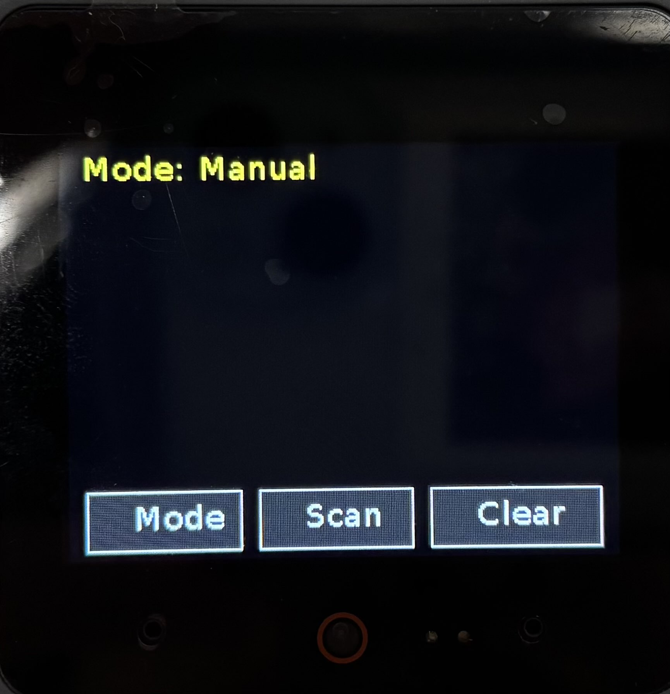
  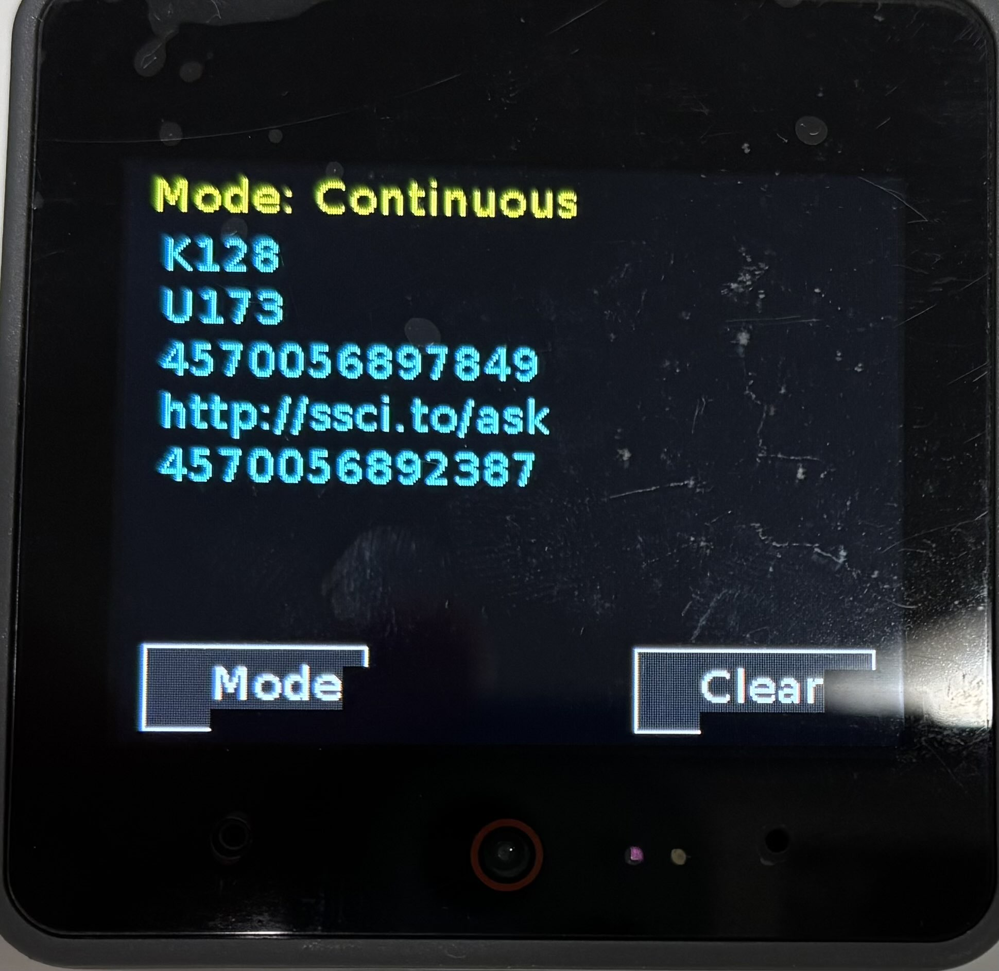

「自身のQRコードを表示する機能」、実装済みだが、写真不足の「地図を表示する機能」、「気象情報を表示する機能」

  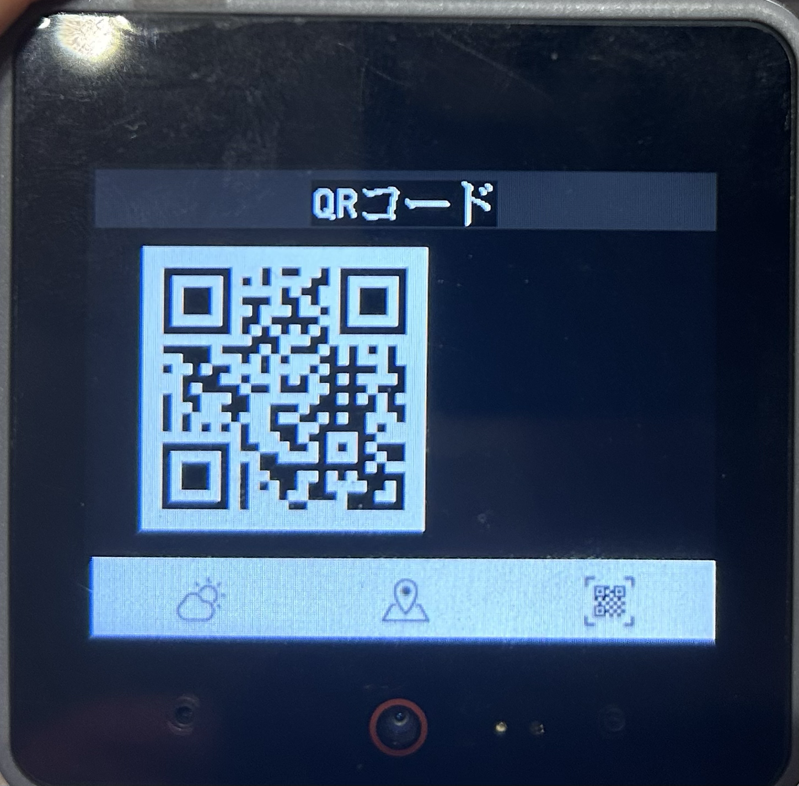
  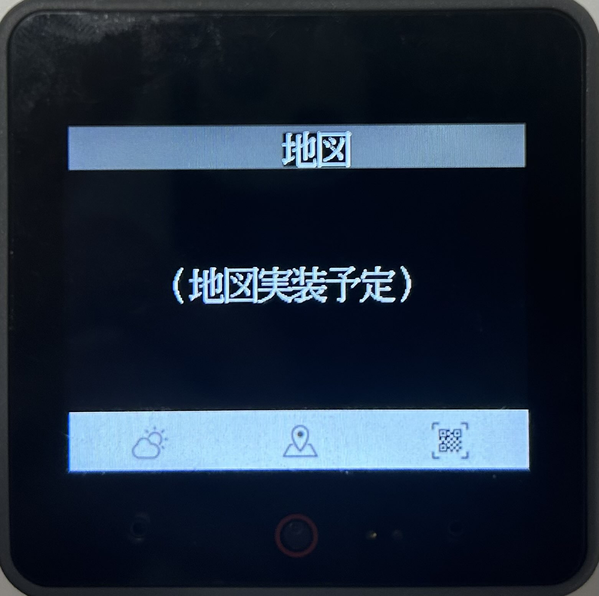
  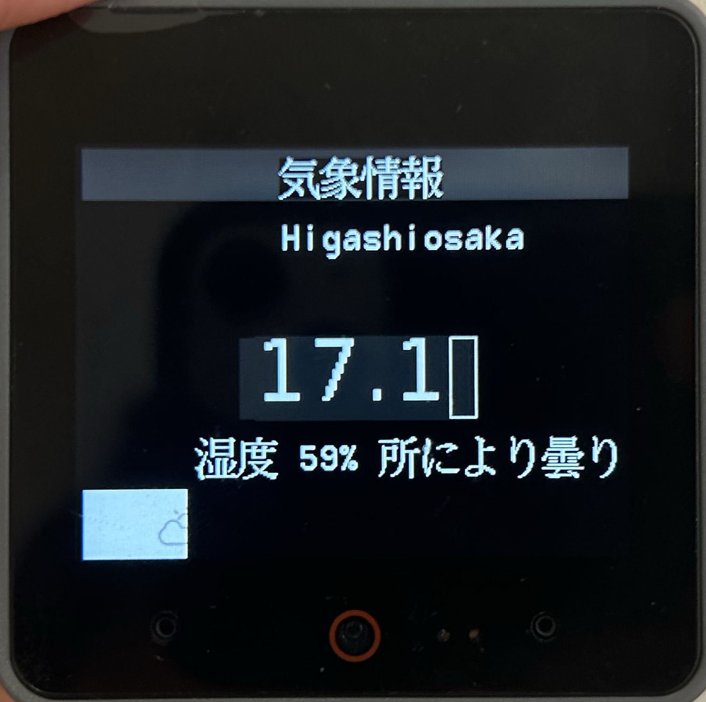

- ショップ側のwebアプリ
「ホーム画面」、「購買の状況分析」、「在庫、顧客の管理」、「商品の情報入力」

  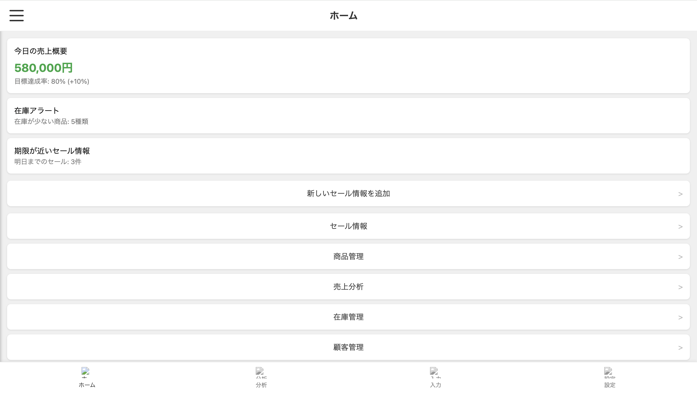
  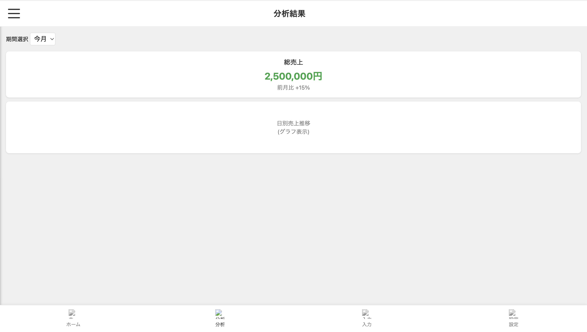
  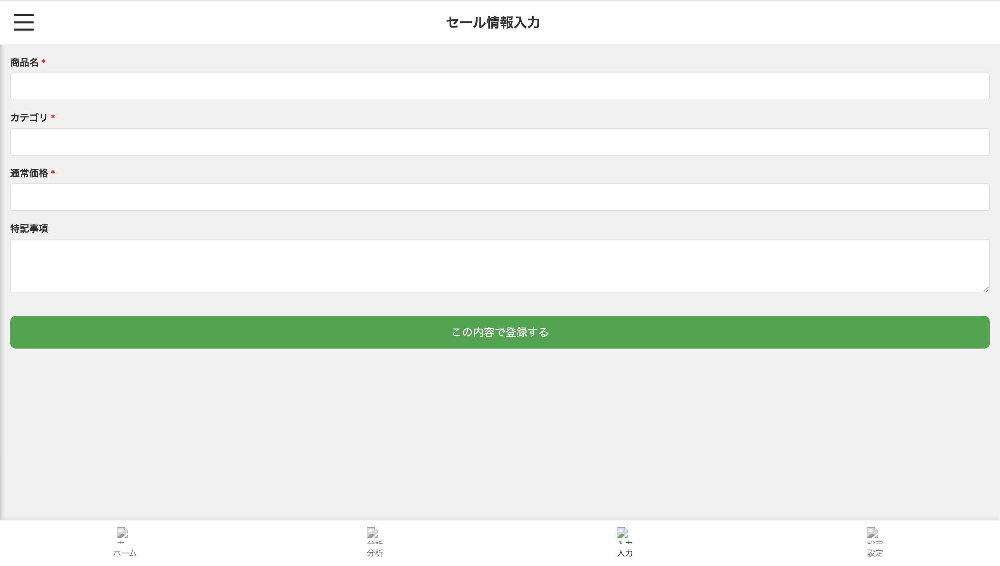
  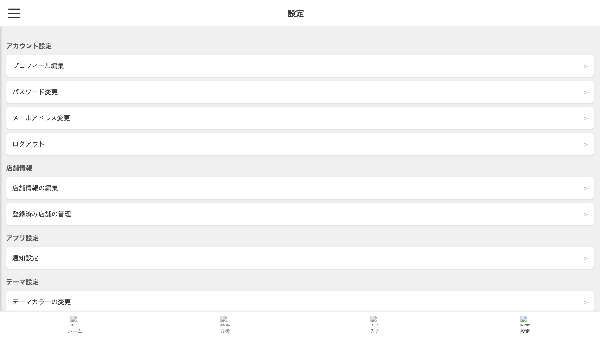

- ユーザー側のwebアプリ画面
左から「冷蔵庫内の在庫確認」、「スーパーのエリア囲って検索」、「レシピ」

  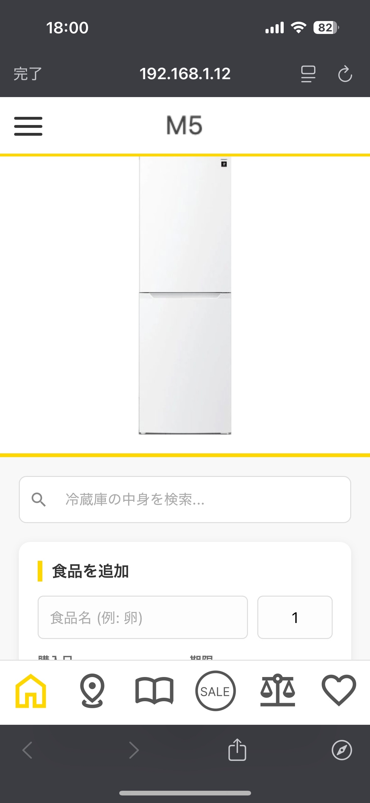
  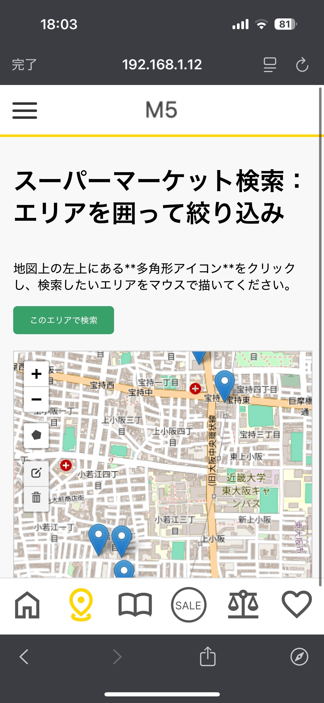
  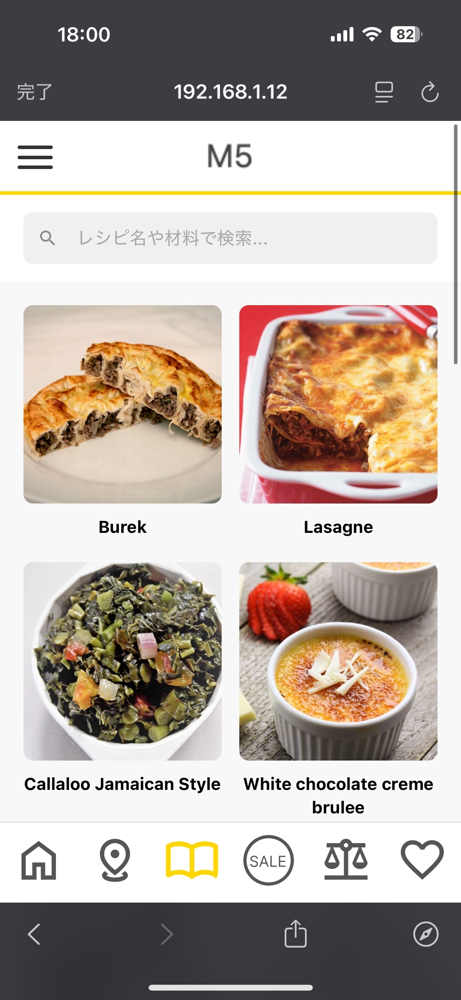

左から「セール情報」、「価格比較」、「ユーザのお気に入り情報」

  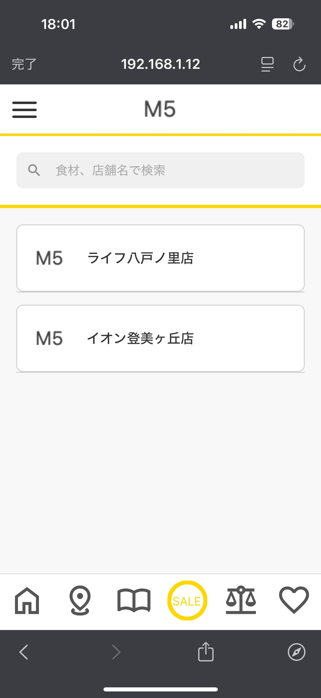
  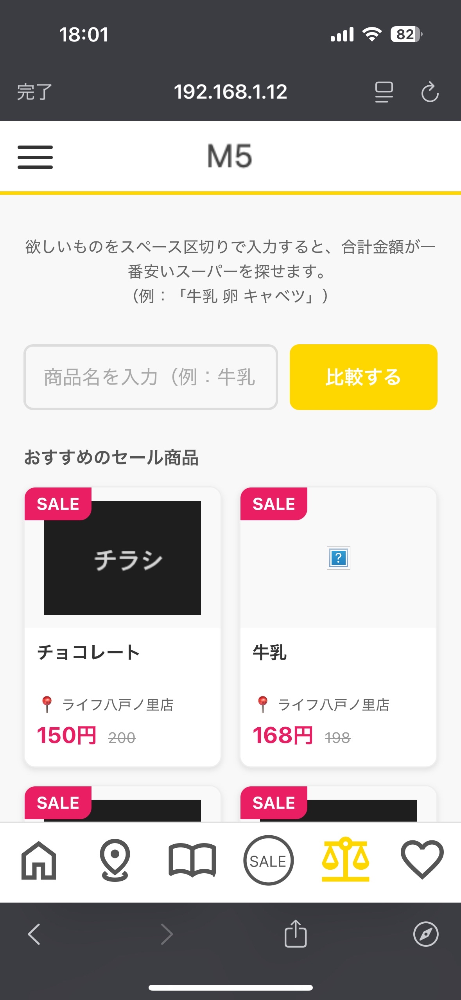
  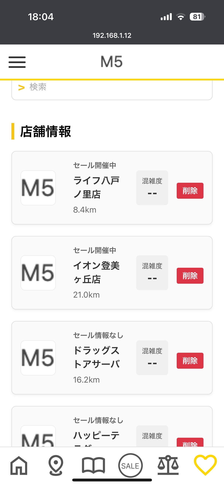

- システム構成図：　

---

### 3.2 残った課題と解決案
webアプリケーション側のユーザ認証機能（ログイン等）、冷蔵庫内食材からのレシピ提案以外の基本的な機能については実装できた。初めて触るM5Stackの面ではいくつかの大きな課題が残った。具体的には、混雑率測定、冷蔵庫内の画像認識である。
以上の詳細を以下の表１に記載した。

表1: 課題と解決案の整理
| 課題 | 現状の問題点 | 完成しなかった理由／不十分な理由 | 改善案（今後の方針） |
|------|--------------|----------------------------------|-------------------------|
| WiFi設定UI(店、ユーザー両方) | クライアント自身のWIFI設定が手動でできない、現在はコード内にハードコーディング | 実装時間不足・仕様整理の遅れ | 各Webアプリでのwifi設定画面追加 |
| 混雑率測定 | 実際の人感センサー連携（現在はrandom.randint(0, 100)でダミー値） | 実装時間不足・仕様整理の遅れ | 人感センサーの導入 |
| 冷蔵庫内の画像認識 | 冷蔵庫内情報をDBから取得していて、リアルタイムに実際の情報を更新できない。 | 実装時間不足・画像認識機能の技術不足 | ユーザーWebアプリの機能で、食品名・個数・購入日・期限を入力して追加（POSTフォーム）で代用 |
| 冷蔵庫内食材からのレシピ提案 | レシピをランダム20件表示しかできなく、冷蔵庫内食材からレシピ提案できない | 実装時間不足・優先度が低く後回し | レシピ提案アルゴリズムの実装 |
| 認証機能（ログイン・ログアウト） | 現在はuser_id=1固定していて、主な認証機能は未実装 | 実装時間不足・優先度が低く後回し | アカウント設定を保存できる認証APIの作成 |
# 4. プロジェクトの進行

## 4.1 全体的な進行の感想
今回の開発では、初期段階で各タスクを定義し、「要件定義→技術リサーチ→UI設計→各プログラム実装→API繋ぎ合わせ→DB実装→テスト」という流れで計画を立てた。
技術リサーチとDB実装の工程で予想以上の時間を要し、全体スケジュールが約10日ほど後ろ倒しになる局面があった。 特に、複数のAPIを組み合わせる際のデータ整合性の確認に手間取り、実装フェーズでの手戻りが発生したことが主な要因である。
この遅延に対し、週1回の授業で「タスクの優先順位付け」を実施した。具体的には、週報を用いて個々のタスクを細分化し、進捗が滞っているメンバーを他がサポートできる体制に役割を再調整した。また、Discordでのテキストベースの進捗報告を毎日行い、小さな疑問点をその場で解消するようにしたことで、後半のテストフェーズでは効率的に作業を進めることができた。
今回の経験から、技術的に不確実な要素が含まれる「リサーチ」や「外部APIの連携」には、あらかじめ20%程度の予備期間を設けるべきだという教訓を得た。次回以降のプロジェクトでは、ガントチャート上のクリティカルパス（遅れると全体に影響する工程）を明確にし、実績との差分を早期に検知して、計画を柔軟に修正するプロセスを徹底したい。

## 4.2 担当者と貢献したこと

- **藤田 彩翔（リーダー）**：
  主に各メンバーのスケジュール管理・技術的なバックアップを担当。DBの設計も担当し、APIの作成・繋ぎ合わせを行った。週次ミーティングを主導し、現状把握と調整に努めた。
  また、実装状況をまとめたドキュメントを作成することで各々がどの部分が実装できており、どの部分がまだ実装できていないのか可視化した。

- **高橋 優也（ユーザ側のwebアプリ）**：  
  客側のWebアプリケーションの制作を担当。それに並行して、最初のデザイン時に決定していなかった動作時のデザインなども担当し、ユーザ側webアプリのアルゴリズム等の開発に全体的に貢献した。

- **田中 咲百（お店側のwebアプリ）**：  
  全体設計に加えて、お店側のWebの制作を担当。お客側のエリアを囲って検索の機能も追加し、web側の遅延を最小限に抑えた。

- **藤井 聖也（UIデザイン、M5stack開発）**：  
  FigmaによるユーザーWebアプリ、ユーザー側M5stackのUI設計とユーザー側M5stackのコーディングを担当。天気情報、地図機能やQRコード表示を実現するために、DockerによるM5stackのhttps通信用のプロキシサーバを設計した

- **西田 陽輝（UIデザイン、M5stack開発）**：  
  Figmaによる店側Webアプリ、店側M5stackのUI設計と店側M5stackのコーディングを担当。QRコードリーダーによる読み取り機能を実装した。APIによるDBとM5stackの情報通信を実装した。

# 5. 参考リスト
>M5Stack で MicroPython を使う - https://oka.medium.com/m5stack-で-micropython-を使う-9a03e8be7ce
>m5stack/uiflow-micropython - GitHub - https://github.com/m5stack/uiflow-micropython
>【M5Stack】UIFlowとMicroPythonで開発を始める - https://qiita.com/sho11hei12-1998/items/372f6312908db27c4486
>M5Stack で MicroPython を使う（ + VSCode から M5Stack を操作する） - https://zenn.dev/ksrnnb/articles/25cbd71bef10c7
>MicroPython libraries - https://docs.micropython.org/en/v1.22.0/library/index.html
>builtins.list - M5StickC UIFlow - https://lang-ship.com/reference/unofficial/M5StickC_UIFlow/class/builtins.list/
>Unit - QR CODE - M5Stack - https://uiflow-micropython.readthedocs.io/en/latest/units/qrcode.html
>【M5Stack】UIFlow (MicroPython) でI2C接続のQRコードリーダー（unit）を使う - https://zenn.dev/yuta_enginner/articles/e09bc7e5d05bac
>天気情報取得用API - Free Weather API - WeatherAPI.com - https://www.weatherapi.com/
>天気情報取得用API - Weather API - OpenWeatherMap - https://openweathermap.org/api
>CoreS3 ファーム書き込み・プログラム配信 - m5-docs - M5Stack - https://docs.m5stack.com/ja/uiflow2/m5cores3/program
>M5stack用Python統合開発環境 - Thonny - https://thonny.org/